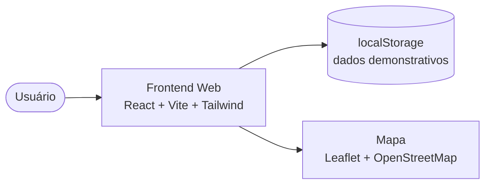
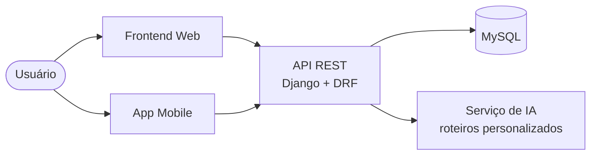

<div align="center">

# Jaboatão 360

**Descubra. Explore. Viva Jaboatão.**

Plataforma digital de turismo e comércio local de Jaboatão dos Guararapes – PE, com mapa interativo, planejamento de roteiros e divulgação de empreendedores da cidade.

[](https://github.com/Micael-exe/jaboatao-360/actions/workflows/ci.yml)


</div>

---

## Sumário

- [Visão geral](#visão-geral)
- [Estado atual do projeto](#estado-atual-do-projeto)
- [Funcionalidades](#funcionalidades)
- [Arquitetura](#arquitetura)
- [Stack tecnológica](#stack-tecnológica)
- [Estrutura do repositório](#estrutura-do-repositório)
- [Primeiros passos](#primeiros-passos)
- [Rotas da aplicação](#rotas-da-aplicação)
- [Persistência de dados (MVP)](#persistência-de-dados-mvp)
- [Qualidade e CI/CD](#qualidade-e-cicd)
- [Guia de contribuição](#guia-de-contribuição)
- [Roadmap](#roadmap)
- [Impacto e ODS](#impacto-e-ods)
- [Documentação](#documentação)
- [Contexto acadêmico e equipe](#contexto-acadêmico-e-equipe)
- [Licença](#licença)

---

## Visão geral

O **Jaboatão 360** amplia a visibilidade dos atrativos turísticos, culturais e naturais de Jaboatão dos Guararapes e conecta **moradores**, **turistas** e **empreendedores locais** em um único lugar.

### O problema

- Atrativos e comércios locais têm pouca visibilidade digital.
- Visitantes não encontram informação centralizada para planejar um passeio.
- Empreendedores locais dependem de divulgação informal para alcançar turistas.

### A solução

Uma plataforma que reúne descoberta de lugares, planejamento de roteiros e vitrine para o comércio local, com a visão de evoluir para recomendações personalizadas por inteligência artificial e gamificação.

### Público-alvo

| Perfil | Necessidade |
|---|---|
| Moradores | Redescobrir a cidade e seus espaços |
| Turistas e visitantes | Planejar passeios com praticidade |
| Empreendedores e comerciantes | Divulgar estabelecimentos e experiências |

---

## Estado atual do projeto

> **Fase atual: MVP web (frontend).** O projeto foi concebido como uma plataforma completa, e esta etapa entrega a interface web navegável, com dados demonstrativos salvos no navegador. Backend, aplicativo mobile e integrações de IA fazem parte do [roadmap](#roadmap).

| Camada | Situação |
|---|---|
| Frontend web (React + Vite) | Implementado (MVP) |
| Testes automatizados e CI | Implementado |
| Backend / API REST | Planejado |
| Banco de dados | Planejado |
| Aplicativo mobile | Planejado |
| Assistente com IA | Planejado |

>  Os dados exibidos (atrativos, comércios, perfil) são **demonstrativos** e ficam apenas no navegador de cada usuário.

---

## Funcionalidades

### Disponíveis no MVP

| Funcionalidade | Descrição |
|---|---|
| **Mapa interativo** | Localização dos principais atrativos da cidade (Leaflet + OpenStreetMap). |
| **Planejamento de roteiros** | Criação de roteiros com paradas de atrativos e comércios, horários, reordenação e salvamento. Roteiros salvos podem ser editados, duplicados e excluídos. |
| **Comércio local** | Vitrine de estabelecimentos e experiências com busca, filtros por tipo e categoria, favoritos e atalho para adicionar ao roteiro. |
| **Perfil do usuário** | Gestão de conta, preferências (interesses, ritmo, orçamento, notificações) e histórico de visitas, com resumo de atividades. |
| **Favoritos** | Marcação de estabelecimentos favoritos (roteiros salvos já ficam registrados na tela de roteiros). |
| **Institucional** | Páginas Início e Sobre. |

### Planejadas

| Funcionalidade | Descrição |
|---|---|
| **Assistente com IA** | Roteiros personalizados conforme interesses, tempo e orçamento. |
| **QR Codes** | Informações históricas e curiosidades nos locais visitados. |
| **Passaporte Jaboatão** | Conquistas e gamificação para incentivar a exploração. |
| **Contas e autenticação** | Login real e sincronização entre dispositivos. |
| **App mobile** | Versão nativa para uso durante os passeios. |

---

## Arquitetura

### Hoje (MVP)



### Visão de destino



### Decisões de design

- **Dados centralizados:** os dados de exemplo ficam em `src/data/dados.js`, facilitando a troca por chamadas à API.
- **Persistência isolada em um hook:** `useLocalStorage` encapsula o armazenamento; migrar para o backend altera um ponto, não as telas.
- **Componentes de página independentes:** cada tela é um módulo em `src/pages`, com seus próprios testes.

---

## Stack tecnológica

### Em uso

| Área | Tecnologia |
|---|---|
| Interface | React 19 |
| Build e dev server | Vite 8 |
| Estilização | Tailwind CSS 4 |
| Roteamento | React Router 7 |
| Mapas | Leaflet + React Leaflet (dados do OpenStreetMap) |
| Requisições HTTP | Axios (preparado para a futura API) |
| Testes | Vitest, React Testing Library, user-event, jsdom |
| Qualidade de código | ESLint 10 (com regras de React Hooks e React Refresh) |
| CI | GitHub Actions |

### Planejadas

| Área | Tecnologia |
|---|---|
| Backend | Python, Django, Django REST Framework |
| Banco de dados | MySQL |
| Mobile | React Native, TypeScript, Expo |
| IA | Serviço de recomendação de roteiros |

---

## Estrutura do repositório

```text
jaboatao-360/
├── .github/
│   └── workflows/
│       └── ci.yml              # Pipeline: lint, testes e build
├── backend/                    # Reservado para a API (planejado)
├── docs/
│   └── DOCUMENTACAO.md         # Documentação técnica da entrega
├── frontend/
│   ├── public/
│   ├── src/
│   │   ├── components/         # Componentes compartilhados (Navbar)
│   │   ├── data/               # Dados demonstrativos
│   │   ├── hooks/              # Hooks reutilizáveis (useLocalStorage)
│   │   ├── pages/              # Telas: Home, Mapa, Roteiros, Comercio, Perfil, Sobre
│   │   ├── test/               # Configuração global dos testes
│   │   ├── App.jsx             # Rotas da aplicação
│   │   └── main.jsx            # Ponto de entrada
│   ├── eslint.config.js
│   ├── package.json
│   └── vite.config.js
└── README.md
```

Os testes ficam ao lado do código que validam (`*.test.js` / `*.test.jsx`).

---

## Primeiros passos

### Pré-requisitos

| Ferramenta | Versão recomendada |
|---|---|
| Node.js | 22 LTS (mínimo 20.19) |
| npm | Incluído com o Node.js |
| Git | Qualquer versão recente |

### Instalação

```bash
# 1. Clone o repositório
git clone https://github.com/Micael-exe/jaboatao-360.git

# 2. Entre na pasta do frontend
cd jaboatao-360/frontend

# 3. Instale as dependências
npm install

# 4. Inicie o servidor de desenvolvimento
npm run dev
```

A aplicação ficará disponível em `http://localhost:5173`.

### Scripts disponíveis

Todos executados dentro de `frontend/`:

| Comando | Descrição |
|---|---|
| `npm run dev` | Inicia o servidor de desenvolvimento com recarga automática |
| `npm run build` | Gera a versão de produção em `dist/` |
| `npm run preview` | Serve localmente a versão de produção |
| `npm run lint` | Analisa o código com o ESLint |
| `npm test` | Executa os testes uma vez |
| `npm run test:watch` | Executa os testes em modo contínuo |

---

## Rotas da aplicação

| Rota | Tela | Descrição |
|---|---|---|
| `/` | Início | Apresentação do projeto e acesso rápido |
| `/mapa` | Mapa | Mapa interativo dos atrativos |
| `/roteiros` | Roteiros | Criação e gestão de roteiros |
| `/comercio` | Comércio local | Vitrine de estabelecimentos e experiências |
| `/perfil` | Perfil | Conta, preferências e histórico de visitas |
| `/sobre` | Sobre | Informações do projeto |

---

## Persistência de dados (MVP)

Enquanto não há backend, as informações ficam no `localStorage` do navegador. Os dados são **privados a cada navegador** e podem ser apagados ao limpar os dados do site.

| Chave | Conteúdo |
|---|---|
| `j360_roteiros` | Roteiros salvos |
| `j360_rascunho` | Roteiro em andamento |
| `j360_favoritos_comercio` | Estabelecimentos favoritados |
| `j360_conta` | Dados da conta |
| `j360_preferencias` | Interesses e preferências |
| `j360_visitas` | Histórico de visitas |

Para reiniciar os dados em desenvolvimento: **DevTools (F12) → Application → Local Storage** e remova as chaves iniciadas por `j360_`.

---

## Qualidade e CI/CD

### Pipeline

A cada `push` e a cada Pull Request, o GitHub Actions executa em ordem, dentro de `frontend/`:

1. **Lint:** `npm run lint`
2. **Testes:** `npm test`
3. **Build:** `npm run build`

Se qualquer etapa falhar, a pipeline fica vermelha e o resultado aparece no commit e no Pull Request. O badge **CI**, no topo deste arquivo, reflete o resultado da branch principal.

### Testes automatizados

Os testes cobrem as três telas novas, o menu de navegação, o hook de persistência e a integridade dos dados, incluindo caminhos felizes, entradas inválidas, casos de borda e integração entre telas. A criação dos cenários contou com **apoio de IA**, sempre com revisão humana e validação pela pipeline.

### Antes de abrir um Pull Request

```bash
cd frontend
npm run lint && npm test && npm run build
```

---

## Guia de contribuição

### Fluxo de trabalho

1. Atualize a `main`: `git checkout main && git pull`.
2. Crie uma branch a partir dela, com o prefixo adequado.
3. Faça commits pequenos e descritivos.
4. Rode lint, testes e build localmente.
5. Envie a branch e abra um Pull Request.
6. Aguarde a pipeline ficar verde e a revisão de pelo menos uma pessoa da equipe.
7. Faça o merge e apague a branch.

### Nomes de branch

| Prefixo | Uso | Exemplo |
|---|---|---|
| `feature/` | Nova funcionalidade | `feature/tela-de-perfil` |
| `fix/` | Correção de bug | `fix/erro-salvar-roteiro` |
| `docs/` | Documentação | `docs/atualiza-readme` |
| `refactor/` | Reorganização sem mudar comportamento | `refactor/hook-storage` |
| `test/` | Testes | `test/cobertura-comercio` |
| `ci/` | Pipeline | `ci/cache-npm` |

### Padrão de commits

O projeto segue o **Conventional Commits**: `tipo(escopo): descrição no presente`.

| Tipo | Quando usar |
|---|---|
| `feat` | Nova funcionalidade |
| `fix` | Correção de bug |
| `docs` | Somente documentação |
| `style` | Formatação, sem mudar comportamento |
| `refactor` | Reorganização de código |
| `perf` | Melhoria de desempenho |
| `test` | Testes |
| `build` | Dependências e processo de build |
| `ci` | Pipeline |
| `chore` | Manutenção geral |
| `revert` | Desfaz um commit anterior |

Exemplo: `fix(roteiros): corrige geração de ids duplicados`

### Checklist do Pull Request

- [ ] O código compila (`npm run build`).
- [ ] O linter passa (`npm run lint`).
- [ ] Os testes passam e novos comportamentos têm testes (`npm test`).
- [ ] O padrão visual do projeto foi mantido.
- [ ] A documentação foi atualizada, se necessário.

---

## Roadmap

| Fase | Entrega | Situação |
|---|---|---|
| **1. MVP web** | Telas de início, mapa, roteiros, comércio, perfil e sobre | Concluída |
| **2. Qualidade** | Testes automatizados e pipeline de CI | Concluída |
| **3. Backend** | API REST, banco de dados e autenticação | Planejada |
| **4. Integração** | Substituir `localStorage` e dados demonstrativos pela API | Planejada |
| **5. Inteligência** | Assistente de IA para roteiros personalizados | Planejada |
| **6. Engajamento** | QR Codes e Passaporte Jaboatão (gamificação) | Planejada |
| **7. Mobile** | Aplicativo nativo | Planejada |

---

## Impacto e ODS

O projeto busca contribuir para:

- Maior visibilidade dos atrativos turísticos;
- Valorização do patrimônio histórico, cultural e natural;
- Incentivo ao turismo sustentável;
- Fortalecimento do comércio e dos empreendedores locais;
- Maior conexão entre moradores e os espaços do município.

| ODS | Contribuição |
|---|---|
| **11 — Cidades e Comunidades Sustentáveis** | Valorização e preservação do patrimônio cultural e natural |
| **8 — Trabalho Decente e Crescimento Econômico** | Fortalecimento do turismo, do comércio e dos empreendedores locais |

---

## Documentação

| Documento | Conteúdo |
|---|---|
| [`docs/DOCUMENTACAO.md`](docs/DOCUMENTACAO.md) | Telas, arquivos, testes, uso de IA e pipeline |

---

## Contexto acadêmico e equipe

Projeto desenvolvido no curso de **Análise e Desenvolvimento de Sistemas (ADS)**, aplicando na prática:

- Desenvolvimento web e mobile;
- Engenharia de software e boas práticas de CI;
- Desenvolvimento de APIs e banco de dados;
- UX/UI;
- Inteligência artificial e geolocalização.

### Equipe

| Nome | Papel |
|---|---|
| _A preencher_ | _A preencher_ |

---

## Licença

Licença ainda não definida. Até a definição, todos os direitos permanecem com os autores do projeto.

---

<div align="center">

### Jaboatão 360

**Descubra. Explore. Viva Jaboatão.**

</div>
