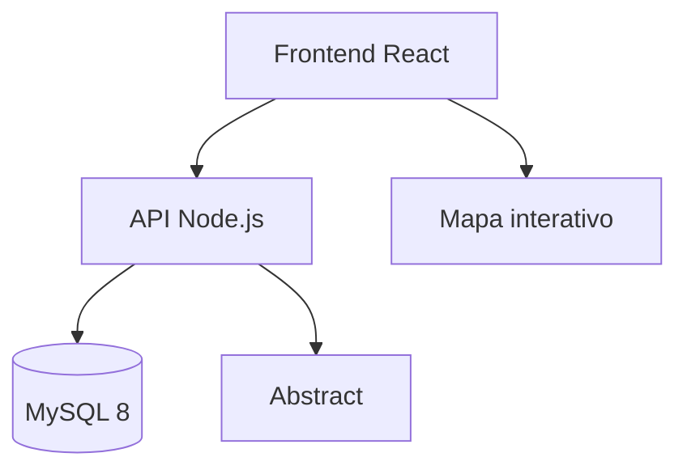

<div align="center">

# Jaboatão 360

**Descubra. Explore. Viva Jaboatão.**

Plataforma digital de turismo e comércio local de Jaboatão dos Guararapes – PE, com mapa interativo, planejamento de roteiros e divulgação de empreendedores da cidade.

[](https://github.com/Micael-exe/jaboatao-360/actions/workflows/ci.yml)


</div>

---

## Sumário

- [Visão geral](#visão-geral)
- [Estado atual do projeto](#estado-atual-do-projeto)
- [Funcionalidades](#funcionalidades)
- [Arquitetura](#arquitetura)
- [Stack tecnológica](#stack-tecnológica)
- [Estrutura do repositório](#estrutura-do-repositório)
- [Primeiros passos](#primeiros-passos)
- [Rotas da aplicação](#rotas-da-aplicação)
- [Persistência de dados](#persistência-de-dados)
- [Qualidade e CI/CD](#qualidade-e-cicd)
- [Guia de contribuição](#guia-de-contribuição)
- [Roadmap](#roadmap)
- [Histórico de versões](#histórico-de-versões)
- [Impacto e ODS](#impacto-e-ods)
- [Documentação](#documentação)
- [Contexto acadêmico e equipe](#contexto-acadêmico-e-equipe)
- [Licença](#licença)

---

## Visão geral

O **Jaboatão 360** amplia a visibilidade dos atrativos turísticos, culturais e naturais de Jaboatão dos Guararapes e conecta **moradores**, **turistas** e **empreendedores locais** em um único lugar.

### O problema

- Atrativos e comércios locais têm pouca visibilidade digital.
- Visitantes não encontram informação centralizada para planejar um passeio.
- Empreendedores locais dependem de divulgação informal para alcançar turistas.

### A solução

Uma plataforma que reúne descoberta de lugares, planejamento de roteiros e vitrine para o comércio local, com a visão de evoluir para recomendações personalizadas por inteligência artificial e gamificação.

### Público-alvo

| Perfil | Necessidade |
|---|---|
| Moradores | Redescobrir a cidade e seus espaços |
| Turistas e visitantes | Planejar passeios com praticidade |
| Empreendedores e comerciantes | Divulgar estabelecimentos e experiências |

Na entrada e no cadastro, as categorias de acesso são **Turista** (inclui moradores), **Empreendedor** e **Empresa**.

---

## Estado atual do projeto

> **Fase atual: MVP web com contas e persistência no MySQL.** Uma pessoa pode entrar em outro navegador e recuperar seus roteiros, preferências e histórico.

| Camada | Situação |
|---|---|
| Frontend web | React e Vite, com catálogo inicial de atrativos e comércios |
| Backend | API Node.js de cadastro, autenticação, sessão e dados pessoais |
| Banco de dados | MySQL 8 com migrações SQL versionadas |
| Verificação de e-mail | Abstract no cadastro e na alteração de endereço |
| Testes e CI | Frontend, API de e-mail e integração com MySQL |
| Aplicativo mobile e assistente de IA | Planejados |

---|---|
| Frontend web (React + Vite) | Implementado (MVP) |
| Testes automatizados e CI | Implementado |
| Backend / API REST | Verificação de e-mail implementada. Autenticação e persistência planejadas |
| Banco de dados | Planejado |
| Aplicativo mobile | Planejado |
| Assistente com IA | Planejado |

>  Os dados exibidos (atrativos, comércios, perfil) são **demonstrativos** e ficam apenas no navegador de cada usuário.

---

## Funcionalidades

### Disponíveis no MVP

| Funcionalidade | Descrição |
|---|---|
| **Mapa interativo** | Localização dos principais atrativos da cidade (Leaflet + OpenStreetMap). |
| **Planejamento de roteiros** | Criação de roteiros com paradas de atrativos e comércios, horários, reordenação e salvamento. Roteiros salvos podem ser editados, duplicados e excluídos. |
| **Comércio local** | Vitrine de estabelecimentos e experiências com busca, filtros por tipo e categoria, favoritos e atalho para adicionar ao roteiro. |
| **Perfil do usuário** | Gestão de conta, preferências (interesses, ritmo, orçamento, notificações) e histórico de visitas, com resumo de atividades. No padrão visual da home e da Sobre: topo escuro com o avatar (iniciais em uma cor da paleta) dentro da escala de graus, indicadores no topo e índice lateral entre Conta, Preferências e Histórico. Para empreendedores e empresas, a conta inclui o nome do negócio. |
| **Login e cadastro** | Entrada (`/login`) e criação de conta (`/cadastro`) separadas por categoria: Turista, Empreendedor e Empresa. Cada categoria tem seu texto, seus campos e suas validações (por exemplo, CNPJ válido para empresa). A senha precisa ter 6 caracteres ou mais, com uma letra maiúscula, um número e um caractere especial. No cadastro, o servidor verifica a entregabilidade do endereço antes de criar a sessão. O servidor guarda um hash da senha com salt individual. Em Perfil → Dados da conta, **Sair da conta** encerra a sessão. |
| **Acesso restrito** | Mapa, Roteiros, Comércio e Perfil só aparecem no menu e no rodapé depois do login ou cadastro. Acessar essas telas pela URL, sem sessão, leva para `/login`. |
| **Favoritos** | Marcação de estabelecimentos favoritos (roteiros salvos já ficam registrados na tela de roteiros). |
| **Página inicial** | Hero com foto de fundo e degradê, indicadores calculados dos dados, atalhos para as telas, atrativos com foto em destaque e lista, comércio local, chamada final e rodapé com a logo do projeto. |
| **Institucional** | Página Sobre com identidade própria no padrão da home: topo com a foto dentro de um círculo com escala de graus (o 360 do nome), índice lateral que acompanha a rolagem, capítulos em coluna de leitura, blocos por público (turistas e moradores, empreendedores), tecnologias por função, chamada final e rodapé. |

### Planejadas

| Funcionalidade | Descrição |
|---|---|
| **Assistente com IA** | Roteiros personalizados conforme interesses, tempo e orçamento. |
| **QR Codes** | Informações históricas e curiosidades nos locais visitados. |
| **Passaporte Jaboatão** | Conquistas e gamificação para incentivar a exploração. |
| **App mobile** | Versão nativa para uso durante os passeios. |

---

## Arquitetura

### Hoje (MVP)



### Decisões de design

- **Catálogo.** O frontend exibe os locais de `frontend/src/data/dados.js`. A migração sincroniza seus identificadores com o banco para que favoritos, visitas e paradas possam referenciá-los.
- **Dados por conta.** A interface usa `useDadosConta`. O módulo `src/data/banco.js` envia as alterações e mantém em memória a última revisão confirmada.
- **Componentes de página independentes:** cada tela é um módulo em `src/pages`. Os testes de interface ficam ao lado das telas cobertas.
- **Conteúdo da home separado:** textos, destaques e atalhos ficam em `src/data/home.js`, e os números da faixa de indicadores são calculados a partir de `dados.js`, sem valores digitados à mão.
- **Fotos por convenção de nome:** a home procura as imagens em `src/assets/jaboatao/` pelo nome do arquivo. Sem a foto, o bloco aparece sem imagem, sem ícone quebrado.
- **Identidade visual das páginas:** as páginas com topo escuro compartilham `Home.css` (cores, container, botões, chamada final) e `Sobre.css` (topo e índice lateral). A Navbar adaptativa vale para todas elas.
- **Acesso.** As regras de formato compartilhadas estão em `src/data/regras.js`. A API autentica a sessão e determina a conta que pode ler ou gravar. O componente `Protegida` cuida da navegação.
- **Evolução do esquema.** Cada alteração estrutural entra em um arquivo numerado em `backend/banco/migracoes/`. A seção 20 da [documentação técnica](docs/DOCUMENTACAO.md) explica como adicionar um campo.

---

## Stack tecnológica

### Em uso

| Área | Tecnologia |
|---|---|
| Interface | React 19 |
| Build e dev server | Vite 8 |
| Estilização | Tailwind CSS 4 |
| Roteamento | React Router 7 |
| Mapas | Leaflet + React Leaflet (dados do OpenStreetMap) |
| Verificação de e-mail | Node.js, Fetch e Abstract Email Intelligence API v1 |
| Contas e persistência | Node.js, mysql2, MySQL 8 e InnoDB |
| Testes | Vitest, React Testing Library, user-event, jsdom e node:test |
| Qualidade de código | ESLint 10 (com regras de React Hooks e React Refresh) |
| CI | GitHub Actions |

### Planejadas

| Área | Tecnologia |
|---|---|
| Mobile | React Native, TypeScript, Expo |
| IA | Serviço de recomendação de roteiros |

---

## Estrutura do repositório

```text
jaboatao-360/
├── .github/
│   └── workflows/
│       └── ci.yml              # Pipeline: lint, testes e build
├── backend/                    # API de contas, sessões e verificação de e-mail
│   └── banco/                  # Acesso ao MySQL, migrações SQL e testes de integração
├── docs/
│   ├── DOCUMENTACAO.md         # Documentação técnica da entrega
│   └── MAPA_INTERATIVO.md      # Fluxo e apresentação do mapa
├── frontend/
│   ├── public/
│   ├── src/
│   │   ├── assets/
│   │   │   ├── jaboatao/       # Fotos da home (ver "Fotos da página inicial")
│   │   │   ├── logo-jaboatao360.webp  # Logo do projeto
│   │   │   ├── logo-jaboatao360-navbar.webp  # Versão leve da logo para a Navbar
│   │   │   └── logo-jaboatao360-navbar-branca.webp  # Logo com texto claro, para fundos escuros
│   │   ├── components/         # Navbar (com Navbar.css), Footer, componentes da home (components/home) e de login e cadastro (components/acesso)
│   │   ├── data/               # Dados demonstrativos (dados.js), conteúdo da home (home.js) e categorias e validações de acesso (acesso.js)
│   │   ├── hooks/              # Hooks de sessão e dados por conta
│   │   ├── pages/              # Telas: Home, Mapa, Roteiros, Comercio, Perfil, Sobre, Login, Cadastro
│   │   ├── test/               # Configuração global dos testes
│   │   ├── App.jsx             # Rotas da aplicação
│   │   └── main.jsx            # Ponto de entrada
│   ├── eslint.config.js
│   ├── package.json
│   └── vite.config.js
└── README.md
```

Os testes ficam ao lado do código que validam (`*.test.js` / `*.test.jsx`).

---

## Primeiros passos

### Pré-requisitos

| Ferramenta | Versão recomendada |
|---|---|
| Node.js | 22.19 ou superior da série 22 |
| MySQL Server | 8.0.16 ou superior da série 8, com InnoDB |
| npm | Incluído com o Node.js |

### Instalação

**1. Prepare o MySQL.** No MySQL Workbench ou no cliente `mysql`, conecte-se como administrador. O exemplo usa o banco e o usuário definidos em `backend/.env.example`. Troque a senha do exemplo antes de executar.

```sql
CREATE DATABASE IF NOT EXISTS jaboatao360 CHARACTER SET utf8mb4 COLLATE utf8mb4_bin;
CREATE USER IF NOT EXISTS 'j360_app'@'localhost' IDENTIFIED BY 'SUBSTITUA_POR_SUA_SENHA';
GRANT SELECT, INSERT, UPDATE, DELETE, CREATE, ALTER, INDEX, REFERENCES
    ON jaboatao360.* TO 'j360_app'@'localhost';
```

**2. Configure o backend.** Copie `backend/.env.example` para `backend/.env.local`. Preencha `DB_PASSWORD` com a senha escolhida e `ABSTRACT_API_KEY` com a chave da Email Intelligence API. Se você está atualizando da versão 1.8.2, transfira essa chave de `frontend/.env.local` para `backend/.env.local`. Confira o host, a porta e o nome do banco.

**3. Inicie a API.** Em um terminal, a partir da raiz do projeto, execute:

```sh
cd backend
npm install
npm run migrate
npm start
```

**4. Inicie o site.** Em um segundo terminal, a partir da raiz, execute:

```sh
cd frontend
npm ci
npm run dev
```

Abra `http://localhost:5173`. A API atende na porta 3001 e o Vite encaminha as requisições a `/api`. Em produção, sirva o frontend por HTTPS, encaminhe `/api/*` para o backend preservando o cabeçalho `Host` e defina `NODE_ENV=production`. Mantenha `frontend/src/data/` na mesma estrutura relativa ao backend, pois a API importa as regras e o catálogo compartilhados. Execute as migrações antes de iniciar a nova versão.

### Scripts disponíveis

Todos executados dentro de `frontend/`:

| Comando | Descrição |
|---|---|
| `npm run dev` | Inicia o servidor de desenvolvimento com recarga automática |
| `npm run build` | Gera a versão de produção em `dist/` |
| `npm run preview` | Serve localmente a versão de produção |
| `npm run lint` | Analisa o código com o ESLint |
| `npm test` | Executa os testes uma vez |
| `npm run test:watch` | Executa os testes em modo contínuo |

### Fotos da página inicial

A home carrega as fotos de `frontend/src/assets/jaboatao/`, pelo **nome do arquivo** (jpg, jpeg, png, webp ou avif):

| Arquivo | Onde aparece |
|---|---|
| `hero` | Fundo do topo da página, com degradê escuro por cima (já incluída) |
| `pilar` | Destaque principal de atrativos: Igreja de Nossa Senhora do Pilar (já incluída) |
| `piedade` | Miniatura na lista: Praia de Piedade |
| `candeias` | Miniatura na lista: Praia de Candeias |
| `guararapes` | Miniatura na lista: Parque Histórico Nacional dos Guararapes |
| `barra-de-jangada` | Miniatura na lista: Praia de Barra de Jangada |
| `morro-da-conceicao` | Miniatura na lista: Morro da Conceição |

Recomendações: WebP, 1600 px de largura para o `hero` e 1000 px para os cards, até ~200 KB cada. Confira a licença de cada foto, dê o crédito exigido (por exemplo, Wikimedia Commons) e revise os textos alternativos em `src/data/home.js`. Sem o arquivo, o bloco aparece sem imagem. Como o `hero` ocupa a largura da tela, prefira uma foto de pelo menos 1600 px.

---

## Rotas da aplicação

| Rota | Tela | Descrição |
|---|---|---|
| `/` | Início | Apresentação do projeto e acesso rápido |
| `/mapa` | Mapa | Mapa interativo dos atrativos. Exige login |
| `/roteiros` | Roteiros | Criação e gestão de roteiros. Exige login |
| `/comercio` | Comércio local | Vitrine de estabelecimentos e experiências. Exige login |
| `/perfil` | Perfil | Conta, preferências e histórico de visitas. Exige login |
| `/login` | Entrar | Login por categoria (Turista, Empreendedor e Empresa). Aceita `?categoria=` |
| `/cadastro` | Cadastro | Criação de conta por categoria. Aceita `?categoria=` |
| `/sobre` | Sobre | Informações do projeto |

---

## Persistência de dados

| O que a pessoa faz | O que fica salvo na conta |
|---|---|
| Cadastra ou edita o perfil | Nome, e-mail, cidade, categoria, avatar e dados do negócio conforme a categoria |
| Ajusta preferências | Interesses, ritmo, orçamento e opções de notificações |
| Marca um comércio ou registra uma visita | Favoritos, atrativo visitado, data e anotação |
| Planeja um passeio | Rascunho, roteiros salvos, data, ordem e horário de cada parada |
| Salva o resultado do mapa | Roteiro disponível em **Meus roteiros**, inclusive com nomes dos locais de catálogos externos |

Quem usava o MVP demonstrativo pode optar por importar os dados no cadastro com o mesmo e-mail, no navegador original. Uma conta já criada no MySQL recebe os novos campos por migração. A seção 20 de [DOCUMENTACAO.md](docs/DOCUMENTACAO.md) descreve os dois fluxos.

---|---|
| `j360_roteiros` | Roteiros salvos |
| `j360_rascunho` | Roteiro em andamento |
| `j360_favoritos_comercio` | Estabelecimentos favoritados |
| `j360_conta` | Dados da conta (para empreendedores e empresas, também o negócio, o ramo, o bairro e o CNPJ) |
| `j360_sessao` | Categoria e e-mail de quem entrou, com a data e a hora. A senha nunca é guardada. Sem essa chave, as telas restritas redirecionam para o login |
| `j360_preferencias` | Interesses e preferências |
| `j360_visitas` | Histórico de visitas |

Para reiniciar os dados em desenvolvimento: **DevTools (F12) → Application → Local Storage** e remova as chaves iniciadas por `j360_`.

---

## Qualidade e CI/CD

### Pipeline

A cada push e Pull Request, o GitHub Actions executa dois trabalhos independentes.

| Trabalho | Verificações |
|---|---|
| Frontend | Instalação, ESLint, Vitest e build do Vite |
| Backend | MySQL 8 isolado, instalação do driver mysql2, testes da Abstract com respostas simuladas e testes de integração de contas e migrações |

Se qualquer etapa falhar, a pipeline fica vermelha e o resultado aparece no commit e no Pull Request. O badge **CI**, no topo deste arquivo, reflete o resultado da branch principal.

### Verificação histórica do frontend

Resultados medidos em 24/11/2026 com Node.js 22.19.0, na revisão [`6711919`](https://github.com/Micael-exe/Jaboatao-360/commit/6711919420e9866f8c93e7e101029595428ba626). Execute os comandos dentro de `frontend/`.

| Comando | Ferramenta | Resultado |
|---|---|---|
| `npm run lint` | ESLint 10.13.0 (`eslint .`) | 55 arquivos examinados, 0 erros e 0 avisos |
| `npm run test` | Vitest 4.1.12 (`vitest run`) | 88 testes aprovados em 14 arquivos |
| `npm run build` | Vite 8.3.5 (`vite build`) | 114 módulos transformados e 13 arquivos gerados em `dist/`, com 773,51 kB antes de compressão |

> **Atenção:** os resultados acima foram medidos na versão 1.7. A tabela de cobertura por arquivo abaixo ainda não foi remedida, porque o pacote `@vitest/coverage-v8` não está instalado no projeto. Rode `npm run lint && npm test && npm run build` em `frontend/` para conferir os números.

#### Testes e cobertura

| Arquivo de teste | Casos | Comportamentos verificados |
|---|---:|---|
| `planejar.test.js` | 11 | Filtros, horários de Recife, ordem das paradas e trechos inacessíveis |
| `Roteiros.test.jsx` | 8 | Validação, criação, reordenação, duplicação e exclusão de roteiros |
| `Comercio.test.jsx` | 6 | Busca, filtros, favoritos e inclusão de locais no roteiro |
| `Perfil.test.jsx` | 5 | Edição do perfil, preferências, notificações e histórico de visitas |
| `dados.test.js` | 5 | Integridade do catálogo, unicidade dos IDs e busca de itens |
| `useLocalStorage.test.js` | 4 | Leitura, gravação, valor inicial e recuperação de JSON inválido |
| `Navbar.test.jsx` | 3 | Destinos dos links e destaque da página atual |
| `Mapa.test.jsx` | 3 | Seleção de lugares, preservação da origem e recuperação após falhas |

O comando padrão executa os testes. Para medir a cobertura, os mesmos casos foram executados em uma cópia instrumentada com **Istanbul**, incluindo todos os 29 arquivos de aplicação `.js` e `.jsx` em `frontend/src/`. Testes, configuração, estilos e o script de treinamento ficaram fora dessa medição.

| Métrica | Executados / total | Cobertura |
|---|---:|---:|
| Linhas executáveis | 423 / 570 | 74,21% |
| Instruções | 520 / 718 | 72,42% |
| Funções | 169 / 257 | 65,75% |
| Ramificações | 311 / 452 | 68,80% |

A lógica de rotas atingiu 98,27% das linhas em `rotas.js` e 97,77% em `planejar.js`. A tela `Mapa.jsx` atingiu 80,45%. Os testes simulam as respostas de rede e substituem `MapaFolha`, por isso a renderização real do Leaflet e a disponibilidade do serviço de rotas ficam fora da suíte. Dezesseis arquivos tiveram 0% das linhas executadas, incluindo `MapaFolha.jsx`, `Home.jsx` e `Sobre.jsx`.

**Bibliotecas externas.** O Vitest executa os casos e fornece asserções e simulações (`vi`). O jsdom simula o navegador. A React Testing Library e a DOM Testing Library permitem renderizar componentes e localizar elementos. `user-event` simula cliques e digitação, `jest-dom` acrescenta verificações sobre o DOM e o `MemoryRouter` do React Router fornece navegação em memória.

**Código do projeto.** Os arquivos `*.test.js` e `*.test.jsx` definem os cenários. Por exemplo, o teste de favoritos clica no botão, verifica a mudança na interface e confere o ID gravado no `localStorage`. O arquivo `src/test/setup.js` simula a rolagem, desmonta os componentes e limpa o armazenamento após cada caso. A criação dos cenários contou com apoio de IA, revisão humana e validação pela pipeline.

#### Lint

A configuração interna `eslint.config.js` aplica 81 regras a 40 arquivos JS/JSX, incluindo os 29 arquivos da aplicação, os 8 arquivos de teste, a preparação dos testes e as duas configurações de ferramentas. O 41º arquivo, `scripts/treinar-roteiro.mjs`, foi lido com zero regras ativas porque a configuração seleciona as extensões `.js` e `.jsx`.

O ESLint usa os pacotes externos `@eslint/js` para as regras de JavaScript, `eslint-plugin-react-hooks` para o uso de hooks e suas dependências, `eslint-plugin-react-refresh` para exportações compatíveis com atualização durante o desenvolvimento e `globals` para reconhecer nomes disponíveis no navegador. A análise inclui páginas como `Home.jsx`, mesmo quando a suíte de testes não as executa.

#### Build de produção

A configuração interna `vite.config.js` registra os plugins externos `@vitejs/plugin-react` e `@tailwindcss/vite`. O Vite parte de `index.html` e `src/main.jsx`, usa o Rolldown para agrupar os módulos e integra o Tailwind CSS à geração dos estilos. O mapa usa `React.lazy()`, o que permite carregar seus arquivos quando o componente é necessário.

| Saída | Tamanho | Com gzip |
|---|---:|---:|
| JavaScript principal | 319,08 kB | 100,27 kB |
| JavaScript do mapa | 155,21 kB | 45,71 kB |
| CSS principal | 40,62 kB | 9,73 kB |
| CSS do mapa | 15,09 kB | 6,36 kB |

Os outros nove arquivos são o HTML de entrada, cinco imagens WebP e três arquivos de ícones. Nesta verificação, os 13 arquivos reconstruídos foram idênticos aos distribuídos no ZIP da revisão analisada.

### Antes de abrir um Pull Request

```bash
cd frontend
npm run lint && npm test && npm run build
```

---

## Guia de contribuição

### Fluxo de trabalho

1. Atualize a `main`: `git checkout main && git pull`.
2. Crie uma branch a partir dela, com o prefixo adequado.
3. Faça commits pequenos e descritivos.
4. Rode lint, testes e build localmente.
5. Envie a branch e abra um Pull Request.
6. Aguarde a pipeline ficar verde e a revisão de pelo menos uma pessoa da equipe.
7. Faça o merge e apague a branch.

### Nomes de branch

| Prefixo | Uso | Exemplo |
|---|---|---|
| `feature/` | Nova funcionalidade | `feature/tela-de-perfil` |
| `fix/` | Correção de bug | `fix/erro-salvar-roteiro` |
| `docs/` | Documentação | `docs/atualiza-readme` |
| `refactor/` | Reorganização sem mudar comportamento | `refactor/hook-storage` |
| `test/` | Testes | `test/cobertura-comercio` |
| `ci/` | Pipeline | `ci/cache-npm` |

### Padrão de commits

O projeto segue o **Conventional Commits**: `tipo(escopo): descrição no presente`.

| Tipo | Quando usar |
|---|---|
| `feat` | Nova funcionalidade |
| `fix` | Correção de bug |
| `docs` | Somente documentação |
| `style` | Formatação, sem mudar comportamento |
| `refactor` | Reorganização de código |
| `perf` | Melhoria de desempenho |
| `test` | Testes |
| `build` | Dependências e processo de build |
| `ci` | Pipeline |
| `chore` | Manutenção geral |
| `revert` | Desfaz um commit anterior |

Exemplo: `fix(roteiros): corrige geração de ids duplicados`

### Checklist do Pull Request

- [ ] O código compila (`npm run build`).
- [ ] O linter passa (`npm run lint`).
- [ ] Os testes passam e novos comportamentos têm testes (`npm test`).
- [ ] O padrão visual do projeto foi mantido.
- [ ] A documentação foi atualizada, se necessário.

---

## Roadmap

| Fase | Entrega | Situação |
|---|---|---|
| **1. MVP web** | Telas de início, mapa, roteiros, comércio, perfil, login, cadastro e sobre | Concluída |
| **2. Qualidade** | Testes automatizados e pipeline de CI | Concluída |
| **3. Backend** | Verificação de e-mail, banco de dados e autenticação | Concluída |
| **4. Integração** | Dados pessoais das telas ligados à API e importação opcional dos registros locais | Concluída |
| **5. Inteligência** | Assistente de IA para roteiros personalizados | Planejada |
| **6. Engajamento** | QR Codes e Passaporte Jaboatão (gamificação) | Planejada |
| **7. Mobile** | Aplicativo nativo | Planejada |

---

## Histórico de versões

| Versão | Entrega |
|---|---|
| **1.9** | Contas e sessões no MySQL, dados de turismo por usuário e migrações versionadas. |
| **1.8.2** | O cadastro passou a consultar a Abstract. Configuração e migração na seção 19 de [DOCUMENTACAO.md](docs/DOCUMENTACAO.md). |
| **1.8.1** | A verificação de e-mail passou a usar a Verifalia. Configuração e migração na seção 18 de [DOCUMENTACAO.md](docs/DOCUMENTACAO.md). |
| **1.8** | API de verificação de e-mail no cadastro, saída pelo Perfil e redesign de Mapa, Roteiros e Comércio. |
| **1.7** | Link "Entrar" oculto na barra depois do login. Regra de senha no cadastro e no login: 6 caracteres ou mais, com uma letra maiúscula, um número e um caractere especial. Documentação atualizada e 88 testes em 14 arquivos. |
| **1.6** | Acesso restrito: Mapa, Roteiros, Comércio e Perfil só aparecem no menu e no rodapé depois do login ou cadastro, e a URL direta sem sessão leva para `/login`. Botão "Continuar sem conta" removido do login. Verificação em `estaLogado()` e rota protegida em `App.jsx`. Documentação atualizada e 76 testes em 13 arquivos. |
| **1.5** | Login e cadastro por categoria: Turista (usuário), Empreendedor e Empresa, em `/login` e `/cadastro`, com campos e validações próprios (inclui CNPJ para empresa), senha com botão mostrar/ocultar e link entre as duas telas. Demonstrativos, sem servidor e sem guardar a senha. O Perfil passa a ter as categorias Turista, Empreendedor e Empresa (em lugar de Morador) e o campo do nome do negócio. Link "Entrar" na Navbar. |
| **1.4** | Redesign da página de Perfil no padrão da home e da Sobre: topo escuro com o avatar em disco com escala de graus, indicadores no topo, índice lateral e seções sem cartões. Emojis removidos; o avatar passa a ser as iniciais em uma de quatro cores da paleta. A Navbar adaptativa passa a valer também em `/perfil`. Rodapé na página. |
| **1.3** | Redesign da página Sobre com identidade própria: topo com a foto em círculo e escala de graus, índice lateral que acompanha a rolagem, capítulos em coluna de leitura, blocos por público, tecnologias agrupadas por função, chamada final e rodapé. A Navbar adaptativa passa a valer também em `/sobre`. |
| **1.2** | Redesign da página inicial: hero com foto e degradê, indicadores reais, atalhos, atrativos com foto em destaque, comércio local, chamada final e rodapé global com a logo nova (usado só na home) e logo nova na Navbar, que fica transparente sobre o topo da home e se adapta à cor da seção ao rolar, e favicon novo. Visual mais sóbrio, sem emojis, ícones decorativos ou animações em cada bloco. Links com React Router e sem novas dependências. |
| **1.1** | Redesign visual "Maré": nova paleta, tipografia, navbar com menu para celular e animações, em todas as telas. |
| **1.0** | Telas de Roteiros, Comércio local e Perfil, testes automatizados e pipeline de CI. |

Detalhes de cada versão em [`docs/DOCUMENTACAO.md`](docs/DOCUMENTACAO.md).

---

## Impacto e ODS

O projeto busca contribuir para:

- Maior visibilidade dos atrativos turísticos;
- Valorização do patrimônio histórico, cultural e natural;
- Incentivo ao turismo sustentável;
- Fortalecimento do comércio e dos empreendedores locais;
- Maior conexão entre moradores e os espaços do município.

| ODS | Contribuição |
|---|---|
| **11 — Cidades e Comunidades Sustentáveis** | Valorização e preservação do patrimônio cultural e natural |
| **8 — Trabalho Decente e Crescimento Econômico** | Fortalecimento do turismo, do comércio e dos empreendedores locais |

---

## Documentação

| Documento | Conteúdo |
|---|---|
| [`docs/DOCUMENTACAO.md`](docs/DOCUMENTACAO.md) | Telas, arquivos, testes, uso de IA, pipeline, redesign visual, redesign da home (v1.2), da Sobre (v1.3) e do Perfil (v1.4) e evolução de cadastro, sessão, modelo de dados e migrações até a v1.9 |
| [Nova funcionalidade do mapa interativo](docs/MAPA_INTERATIVO.md) | Escolha de lugares por fotos e sugestão de roteiro com horários de visita |

---

## Contexto acadêmico e equipe

Projeto desenvolvido no curso de **Análise e Desenvolvimento de Sistemas (ADS)**, aplicando na prática:

- Desenvolvimento web e mobile;
- Engenharia de software e boas práticas de CI;
- Desenvolvimento de APIs e banco de dados;
- UX/UI;
- Inteligência artificial e geolocalização.

### Equipe

| Nome | Papel |
|---|---|
| _A preencher_ | _A preencher_ |

---

## Licença

Licença ainda não definida. Até a definição, todos os direitos permanecem com os autores do projeto.

---

<div align="center">

### Jaboatão 360

**Descubra. Explore. Viva Jaboatão.**

</div>
